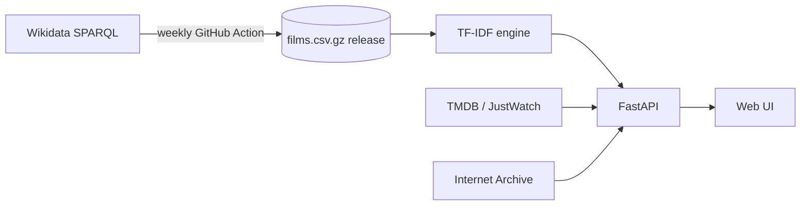

# Recommend-It

[](https://colab.research.google.com/github/sushmoydatta/Recommend-It/blob/main/Movie_Recommender.ipynb)

A content-based movie recommender covering **the whole IMDb film catalogue, from the 1890s to this year's releases**. It also tells you **where each film can be watched legally**, with **free options listed first**.

```
$ python cli.py recommend "Inception" --top 3 --watch --region IN

Because you liked Inception (2010), you might enjoy:

  1. Interstellar (2014)  ·  ★ 8.7  ·  Adventure, Drama, Sci-Fi  ·  match 0.41
       🆓 Free: Amazon MX Player (Free with ads)
       💳 Subscription: Netflix; Rent: Apple TV, Google Play Movies
       🔗 https://www.themoviedb.org/movie/157336-interstellar/watch?locale=IN
  ...
```
*(Illustrative output. Availability changes over time and differs by country.)*

## Website

A public web app ships in `recommend_it/web`: search-as-you-type, recommendations, posters, and a **"Free to watch only"** filter that lists legal free and ad-supported options for your country.

```bash
pip install -r requirements-web.txt
python cli.py build-data --source wikidata --out data/movies-wikidata.csv.gz   # ~1h, CC0 data
RECOMMEND_IT_DATA=data/movies-wikidata.csv.gz uvicorn recommend_it.web.app:app --port 8000
```

### Why the website uses Wikidata

IMDb's datasets are licensed for personal, non-commercial use only, so they can't power a public site. The website uses **Wikidata (CC0)**: over 300k films with genres, directors, cast and subjects. Popularity comes from how many Wikipedia language editions have an article on the film. A GitHub Action (`.github/workflows/dataset.yml`) rebuilds it weekly and publishes it as the `dataset` release asset, which the website downloads.

### Deploy to Hugging Face Spaces (free, recommended)

The app needs about 0.5–1 GB of RAM, more than most free tiers (Render's free tier has 512 MB). Hugging Face's free CPU Spaces have 16 GB.

1. Publish the dataset once: **Actions → dataset → Run workflow** (takes about an hour). This creates the `dataset` release.
2. Create a Space at huggingface.co/new-space with **SDK: Docker**, blank template.
3. Push this repository to it:
   ```bash
   git remote add space https://huggingface.co/spaces/<your-user>/recommend-it
   git push space main
   ```
4. Optional: in the Space's **Settings → Variables and secrets**, add the secret `TMDB_READ_TOKEN` (your TMDB "API Read Access Token") to get posters and per-service availability.

The `Dockerfile` also works on Render, Fly.io, Railway or Google Cloud Run. Set the `PORT` env var and give it at least 1 GB of RAM.

### Web configuration

| Variable | Default | Purpose |
|---|---|---|
| `RECOMMEND_IT_DATA` | `data/movies.csv.gz` | Dataset path |
| `RECOMMEND_IT_DATA_URL` | the GitHub `dataset` release | Downloaded at startup or build time if the file is missing |
| `TMDB_READ_TOKEN` / `TMDB_API_KEY` | none | Posters, plots, exact streaming availability |
| `RATE_LIMIT_PER_MIN` | `90` | API requests per minute per IP |
| `SITE_AUTHOR` | none | Your name, shown as "Built by …" |
| `SITE_AUTHOR_URL` | none | Your portfolio or LinkedIn URL |
| `SITE_GITHUB_URL` | this repo | Source-code link on the site |

## For reviewers

**Live demo:** _add your Hugging Face Space link here_ · **Stack:** Python, pandas, scikit-learn, FastAPI, vanilla JS, Docker, GitHub Actions

What's worth looking at:

- **Data engineering:** [`wikidata.py`](recommend_it/wikidata.py) pulls 300k+ films through batched SPARQL queries. It respects rate limits, sets hard request deadlines, and checkpoints batches so an interrupted build resumes. [`dataset.py`](recommend_it/dataset.py) streams IMDb's multi-GB dumps in chunks.
- **Recommendation engine:** [`engine.py`](recommend_it/engine.py) builds weighted TF-IDF over genres, people and subjects. It computes similarity for one film on demand (about 50 ms over 300k films, low memory), blends in a popularity prior, and matches titles exact → prefix → fuzzy.
- **Product:** [`web/`](recommend_it/web) is a FastAPI API with rate limiting, caching and security headers, plus a dependency-free frontend: search-as-you-type, shareable links, dark mode and a mobile layout.
- **Responsible design:** licence-aware data sources, legal-only streaming links, and correct attribution.
- **Quality:** pytest suite with fixture and mocked-network tests, CI on every push, and a reproducible Docker image.



## Quick start

```bash
pip install -r requirements.txt          # or: pip install -e .   (adds a `recommend-it` command)
python cli.py build-data                 # downloads IMDb dumps (~1.5 GB) and builds data/movies.csv.gz
python cli.py recommend "The Dark Knight"
```

The build takes about 5–10 minutes and is needed only once. Run it again whenever you want the newest films; IMDb refreshes its dumps daily.

### Commands

| Command | What it does |
|---|---|
| `python cli.py recommend "Dune (2021)" --top 15` | Similar films. Add the year to tell remakes apart |
| `python cli.py recommend "Spirited Away" --watch --region IN` | Also show where each one streams in your country |
| `python cli.py recommend "Nosferatu" --watch --free-only` | Keep only films you can watch for free |
| `python cli.py watch "The General"` | Where to watch one film |
| `python cli.py search "godfather"` | Browse matching titles |
| `python cli.py` | Interactive mode |
| `... --json` | Machine-readable output for any command |

The old style `python cli.py "Inception" --top 5` still works.

## Where to watch, including free

Turn on exact per-service availability with a **free TMDB API key** (sign up at themoviedb.org → Settings → API):

```bash
export TMDB_API_KEY=your_key            # or TMDB_READ_TOKEN=<v4 read access token>
export RECOMMEND_IT_REGION=IN           # your country (ISO code), default US
```

| Source | Needs key | What you get |
|---|---|---|
| TMDB watch providers (data by **JustWatch**) | yes | Per country: **free / free-with-ads** services (Tubi, Pluto TV, Plex, The Roku Channel, Amazon MX Player, YouTube…), then subscription, rent and buy |
| Internet Archive *Feature Films* | no | Direct links to legally free **public-domain** films (mostly older films whose copyright has expired or lapsed) |
| JustWatch / Tubi search links | no | Shown when no key is set, so you can check by hand |

> **No pirate sites.** Recommend-It only points to licensed or public-domain sources. Sites that stream new releases "for free" without a licence are copyright infringement, and they are a common source of malware and scam ads. Ad-supported services such as Tubi, Pluto TV, Plex and MX Player are the legal way to watch thousands of films free.

## How it works

1. **Dataset**: `build-data` streams the official [IMDb non-commercial datasets](https://developer.imdb.com/non-commercial-datasets/): every feature film with at least 50 votes (`--min-votes`), with genres, directors, top-billed cast, year, runtime, rating and vote count. Adult titles are excluded. With `--tmdb-enrich 20000` (needs a TMDB key) the most-voted films also get plot overviews, taglines and keywords, which makes recommendations noticeably better.
2. **Features**: genres, directors and cast become single tokens (`p_tomhanks`), so actors who share a first name don't look related. Genres are weighted ×3 and directors ×2, and any plot or keyword text is added with English stop-words removed.
3. **Vectorization**: TF-IDF, computed once and cached in `data/.cache/`.
4. **Ranking**: cosine similarity is computed for the query film only, one sparse row, so it's fast and light on memory even with 300k films. Scores are then blended with a Bayesian-weighted rating (`quality_weight=0.15`) so good films rank ahead of obscure ones.
5. **Title matching**: exact match first, then whole-word partial match, then typo-tolerant fuzzy match. Ties go to the most-voted film. `Title (Year)` picks a specific version.

The classic Kaggle *TMDB 5000* CSV still works too: `python cli.py recommend Avatar --data movies.csv`.

## Python API

```python
from recommend_it import MovieRecommender
from recommend_it.watch import where_to_watch

engine = MovieRecommender("data/movies.csv.gz")
matched, recs = engine.recommend("Parasite", top_n=10)
info = where_to_watch(recs[0].title, recs[0].year, imdb_id=recs[0].imdb_id, region="IN")
print([o.provider for o in info.free_offers])
```

## Project structure

```
recommend_it/
├── engine.py     # recommender: features, TF-IDF, ranking, title search
├── dataset.py    # IMDb download + build, optional TMDB enrichment
├── watch.py      # legal where-to-watch lookup (TMDB/JustWatch, Internet Archive)
├── wikidata.py   # CC0 dataset builder for the public website
├── web/          # FastAPI app + static frontend (index.html, app.js, style.css)
├── tmdb.py       # minimal TMDB client
├── http.py       # stdlib HTTP helpers
└── cli.py        # command-line interface
cli.py            # `python cli.py ...` entry point
tests/            # pytest suite (no network needed)
Dockerfile        # website image (Hugging Face Spaces, Render, Fly.io...)
.github/workflows # tests + weekly dataset rebuild
Movie_Recommender.ipynb   # original exploration notebook
```

Run the tests with `pip install pytest && pytest`.

## Data terms

IMDb data is for personal and non-commercial use only. Don't commit or redistribute the built dataset. TMDB data requires attribution: *"This product uses the TMDB API but is not endorsed or certified by TMDB."* Streaming availability is provided by JustWatch.

## License

MIT, see [LICENSE](LICENSE).
